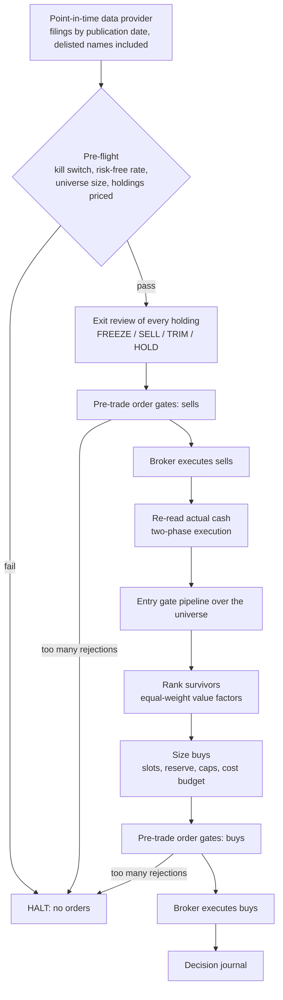

# Babylon Value: Strategy Plan

A rules-based equity strategy that tries to earn alpha by buying deeply undervalued, financially sound
businesses. Its rules come from two sources:

* **Deep value investing:** Benjamin Graham (*Security Analysis*, *The Intelligent Investor*), Joel
  Greenblatt (*The Little Book That Beats the Market*) and Tobias Carlisle (*Deep Value*, *The Acquirer's
  Multiple*).
* **George S. Clason, *The Richest Man in Babylon*:** the Seven Cures for a Lean Purse and the Five Laws
  of Gold.

The design goal is a system whose logic gates are **failsafe** (anything unexpected stops capital from
moving) and **unbiased** (no look-ahead, no survivorship bias, no curve-fitting, no discretionary
overrides).

> **Honest framing.** No rule set guarantees alpha. Deep value has had decade-long droughts (US value
> lagged growth for most of 2007–2020). The edge it targets comes from behaviour: investors overreact to
> bad news and prices of unloved, cheap companies tend to revert. That edge only pays an investor who
> sticks to the rules through long stretches of underperformance, which is exactly why the rules are
> mechanical. Every number in this plan must be validated on real point-in-time data (Phase 3) before
> real money is involved.

---

## 1. Principles → rules

Every rule is labelled with the principle it serves (`babylon_value/principles.py`), and every decision
in the journal carries that label.

### The Five Laws of Gold

| Law | Clason | Rule in the system |
|---|---|---|
| 1 | Gold comes gladly to the man who puts by not less than one-tenth of his earnings | Periodic contributions are part of the strategy. The backtester models monthly deposits, and contributions are deployed only through the same gates. |
| 2 | Gold labours diligently for the owner who finds it profitable employment | **Earnings yield hurdle:** EBIT/EV must be at least 2× the risk-free rate (Graham). If a safe bond pays nearly as much, the gold is not "profitably employed". Idle cash above the reserve is put to work at each rebalance. |
| 3 | Gold clings to the cautious owner who invests under the advice of men wise in its handling | Rules come from published, peer-reviewed research, not tips: **Piotroski F-score ≥ 6** filters value traps; Altman and Beneish screens guard the downside. |
| 4 | Gold slips away from the man who invests in businesses he is not familiar with | **Circle of competence:** ordinary shares of US-headquartered companies on NYSE, NASDAQ or NYSE American; banks, insurers, REITs and utilities excluded (EV/EBIT and the current ratio don't apply to them); minimum revenue; no unclassified businesses. |
| 5 | Gold flees the man who forces it to impossible earnings or follows tricksters | **No tricksters:** Beneish M-score ≤ −1.78 (earnings manipulation), share dilution ≤ 5%/yr, dividend yield ≤ 10% and covered by free cash flow, no penny stocks (price ≥ $2, market cap ≥ $50M). No leverage, options or shorting, ever. |

### The Seven Cures for a Lean Purse

| Cure | Clason | Rule in the system |
|---|---|---|
| 1 | Start thy purse to fattening | Same as Law 1: contributions. |
| 2 | Control thy expenditures | Cost model (commission + slippage); per-rebalance cost budget (0.5% of NAV); minimum trade size; ≤ 10% of daily volume per order; minimum liquidity gate; quarterly rebalancing on a fixed calendar; entry/exit **hysteresis** so positions aren't churned. |
| 3 | Make thy gold multiply | Dividends reinvested; cash above the reserve deployed into the best-ranked bargains; holdings that still pass every gate are topped up to target weight. |
| 4 | Guard thy treasures from loss | Altman Z ≥ 1.81, current ratio ≥ 1.5, debt/equity ≤ 1, interest coverage ≥ 3×, operating profit in ≥ 4 of 5 years; 25 equal-weight positions; position cap 7%; sector cap 25%; a holding whose thesis breaks is sold. |
| 5 | Make of thy dwelling a profitable investment | Read as "own real, productive property": **tangible equity must be positive**, so the business is backed by real assets, not just goodwill. (An interpretation; the book's literal advice is about owning your home.) |
| 6 | Insure a future income | A **10% cash reserve** that is never invested and is checked by the order gates. If too few bargains qualify, the remaining cash simply waits. |
| 7 | Increase thy ability to earn | An append-only **decision journal** recording every gate verdict, exit, order and fill with the configuration fingerprint; `explain` shows the full gate tree for any security; post-mortems use the journal. |

Mathon the gold lender's rule, *"Better a little caution than a great regret"*, is how every uncertain
case is resolved: if a check cannot be decided, the answer is no.

### Deep value canon

| Idea | Source | Rule |
|---|---|---|
| Margin of safety | Graham | Buy only when cheap on earnings **or** on assets (below). |
| Acquirer's Multiple | Carlisle; Greenblatt | EV/EBIT ≤ 8. |
| Net-net | Graham | Market cap ≤ ⅔ of NCAV (current assets − all liabilities − preferred), profitable only. |
| Value-trap filter | Piotroski (2000) | F-score ≥ 6 of 9. |
| Mean reversion & sell discipline | Graham; Carlisle | Sell at fair value (EV/EBIT ≥ 15 or market cap ≥ NCAV), or after a 50% gain / two years unless the stock would still be bought today. |
| Diversification, equal weight | Graham (10–30 issues); Carlisle | 25 equal-weight positions; no conviction sizing. |

---

## 2. Architecture



| Module | Responsibility |
|---|---|
| `principles.py` | The principle labels. |
| `config.py` | Every parameter, grouped by principle with its source; frozen; `validate()` refuses unsafe configs; `fingerprint()`. |
| `models.py` | Point-in-time data model (`FinancialPeriod` has an `available_date`). |
| `metrics.py` | EV, NCAV, Altman Z, Piotroski F, Beneish M, and so on. Each returns a finite number or raises; never a default. |
| `logic.py` | Three-valued fail-closed gates: `LeafGate`, `AllOf` (AND), `AnyOf` (OR). |
| `gates/` | The rules, one module per principle, assembled into the entry and thesis pipelines. |
| `ranking.py` | Deterministic ranking of survivors. |
| `exits.py` | Sell discipline. |
| `orders.py` | Orders and the pre-trade risk gates (long-only, no leverage, caps). |
| `execution.py` | `Broker` protocol and `PaperBroker`. |
| `engine.py` | One rebalance with pre-flight checks and circuit breakers. |
| `backtest.py` | Monthly point-in-time backtester and performance and alpha metrics. |
| `data/` | Provider protocol (splits, share counts, quality flags), CSV format, synthetic generator. |
| `data/edgar.py` | SEC EDGAR client and XBRL → point-in-time annual reports (§12). |
| `data/live.py` | Builds the live dataset from EDGAR + IB prices, with split-safety flags (§12). |
| `ibkr.py` | Interactive Brokers paper-only broker, ledger and gateway over `ib_async` (§12). |
| `net.py` | Rate-limited, retrying, cached HTTPS JSON client (standard library). |
| `journal.py` | Append-only JSON Lines decision journal. |

**Language choice: Python, standard library only.** The strategy rebalances quarterly over a few
thousand stocks: about 100,000 gate evaluations a year, which take seconds. C++ would buy speed this
problem doesn't need while making the rules harder to read and audit. With zero runtime dependencies
there's no third-party code in the decision path. If the system ever moves to intraday execution,
the order router (not the rules) is the place for a faster language.

---

## 3. The logic gates

Each gate is a small, pure check on one security on one date that returns **PASS**, **FAIL** or
**ERROR**:

* **PASS / FAIL:** evaluated on valid data; rule satisfied or not.
* **ERROR:** could not be evaluated (missing field, zero denominator, exception, malformed answer).

Gates combine with AND and OR. **ERROR is infectious** (Bochvar's three-valued logic), and only an
explicit PASS at the root can lead to a buy:

```
AND    | PASS   FAIL   ERROR          OR     | PASS   FAIL   ERROR
-------+--------------------          -------+--------------------
PASS   | PASS   FAIL   ERROR          PASS   | PASS   PASS   ERROR
FAIL   | FAIL   FAIL   ERROR          FAIL   | PASS   FAIL   ERROR
ERROR  | ERROR  ERROR  ERROR          ERROR  | ERROR  ERROR  ERROR
```

Design rules that make the gates failsafe:

1. **Default deny.** An empty AND/OR is ERROR (a vacuous "true" is how fail-open bugs happen).
2. **No NOT gate.** Negating an indeterminate answer turns "don't know" into "yes".
3. **No defaults for missing data.** Metrics raise `MetricUnavailable` instead of using 0; the CSV loader
   reads blank cells as NaN, which the completeness gate rejects.
4. **Strict verdicts.** A gate must return a real boolean and finite metrics, or its answer is ERROR.
5. **Exceptions are contained, except one.** Any exception inside a gate becomes ERROR, apart from
   `LookAheadBiasError`, which halts the entire run because it means the data pipeline is broken.
6. **Short-circuit only on integrity.** If data integrity fails, nothing else is computed on that data.
   Elsewhere every gate is evaluated, so the journal shows *every* reason a stock was rejected.

### Entry pipeline

```
entry = AND[short-circuit](
  data_integrity      point_in_time · data_quality · history_depth(5y) · completeness · freshness ·
                      accounting_identity
  investment_case = AND(
    circle_of_competence   security_type · exchange · country · sector · established_business (Law 4)
    guard_thy_treasure     altman_z · liquidity · leverage · earnings_stability ·
                           tangible_backing                                             (Cure 4, Cure 5)
    no_tricksters          beneish_m_score · dilution · dividend_sustainability ·
                           penny_stock                                                  (Law 5)
    control_expenditures   tradability                                                  (Cure 2)
    profitable_employment = AND(                                                        (Law 2, Law 3)
      margin_of_safety = OR( AND(acquirers_multiple, earnings_yield_hurdle), net_net ),
      piotroski)))
```

| Gate | Rule (default) | Source |
|---|---|---|
| point_in_time | every report's `available_date` and the price date ≤ decision date, else **halt** | bias control |
| data_quality | no open data-quality flag (e.g. a share count that may predate a split, §12) | failsafe |
| history_depth | ≥ 5 consecutive annual reports | Graham |
| completeness | every field finite, correct sign, assets & shares > 0 | failsafe |
| freshness | price ≤ 7 days old; latest annual report ≤ 456 days old | failsafe |
| accounting_identity | assets = liabilities + equity (±2%); components ≤ totals | failsafe |
| security_type / exchange | common stock on NYSE, NASDAQ, NYSE American | Law 4 |
| country | headquarters in the US | Law 4 |
| sector | not Financials, Real Estate, Utilities, or unclassified | Law 4; Greenblatt |
| established_business | revenue ≥ $50M | Law 4 |
| altman_z | Z ≥ 1.81 | Altman (1968) |
| liquidity | current ratio ≥ 1.5 | Graham |
| leverage | equity > 0, debt/equity ≤ 1.0, EBIT/interest ≥ 3 | Graham; Cure 4 |
| earnings_stability | latest EBIT > 0 and positive in ≥ 4 of 5 years | Graham |
| tangible_backing | equity − intangibles − preferred > 0 | Cure 5 |
| beneish_m_score | M ≤ −1.78 | Beneish (1999) |
| dilution | share count growth ≤ 5% | Law 5 |
| dividend_sustainability | yield ≤ 10% and dividends ≤ free cash flow | Law 5 |
| penny_stock | price ≥ $2 and market cap ≥ $50M | Law 5 |
| tradability | average daily dollar volume ≥ $500k | Cure 2 |
| acquirers_multiple | EBIT > 0, EV > 0, EV/EBIT ≤ 8 | Carlisle |
| earnings_yield_hurdle | EBIT/EV ≥ 2 × risk-free | Graham; Law 2 |
| net_net | EBIT > 0, NCAV > 0, market cap ≤ 0.67 × NCAV | Graham |
| piotroski | F-score ≥ 6 | Piotroski (2000) |

The **thesis pipeline** used for holdings is the same tree without the valuation and tradability
stages.

---

## 4. Ranking

Survivors are ranked by the average of four percentile ranks, **equally weighted** so nothing is tuned
by hand: earnings yield (EBIT/EV), NCAV / market cap, tangible book / market cap and FCF / market cap.
Ties go to the higher F-score, then alphabetical order, so the result is fully deterministic. A
security that passes every gate but can't be ranked is not bought.

## 5. Portfolio construction

* Target **25 positions, equal weight**: (1 − reserve) / 25 = 3.6% each.
* **10% cash reserve**, never spent. Fewer than 25 bargains means more cash, not looser standards.
* Caps: 7% per position (trimmed back to target above it), 25% per sector, 6% of NAV per order,
  10% of average daily volume per order.
* New positions are filled best-ranked first; spare cash then tops up holdings that **still pass every
  entry gate today** (never averaging down into a broken thesis).
* Rebalances happen on a fixed calendar (end of March, June, September, December); contributions and
  dividends accumulate as cash in between.

## 6. Sell discipline

In order of precedence (`exits.py`):

1. **FREEZE:** a holding's data is missing or fails integrity. Don't trade on data you can't trust;
   alert a human. It is also not topped up.
2. **SELL: thesis broken.** Any competence, safety or trickster gate now fails. Safety comes before cost
   and is never blocked by the cost budget.
3. **SELL: fair value.** EV/EBIT ≥ 15 and not still a net-net (market cap ≥ NCAV). Entry is ≤ 8, so the
   gap between 8 and 15 is the hysteresis band where a holding is kept but not added to.
4. **SELL: Graham's rule.** A 50% gain, or two years without the value being realised, *unless* the
   stock would still pass every entry gate today (selling and rebuying it would only cost money).
5. **TRIM** above 7% weight.
6. **HOLD** otherwise.

**No price stop-losses.** A deep value strategy buys what others are dumping, so a stop-loss would sell
its own bargains at the worst moment. Downside is controlled by the safety gates, diversification and
caps.

## 7. Execution safety

* **Hard-coded invariants** (no config can switch them off): long only, no leverage, whole shares, limit
  orders within ±2% of the reference price, and a buy only for a security that passed every gate on that
  date. The `PaperBroker` enforces "no short, no borrowing" again on its own.
* **Pre-flight halts:** kill switch (an unreadable switch counts as engaged), implausible risk-free rate,
  empty universe, universe shrinking > 50% between runs, any holding that can't be priced, invalid cash.
* **Two-phase execution:** buys are sized from the cash the broker reports *after* sells settle.
* **Batch circuit breaker:** if > 25% of a batch fails the pre-trade gates, the whole batch is withheld
  (sizing and gates disagreeing means there is a defect).
* **Config validation:** the engine refuses to start on an unsafe configuration (e.g. < 10 positions,
  exit threshold not looser than entry, reserve > 50%).
* **Paper trading only.** The Interactive Brokers adapter refuses any account that isn't a paper account
  (§12); there is no live-trading switch.

## 8. Bias controls

| Bias | Control |
|---|---|
| Look-ahead | Fundamentals filtered by filing date; restatements visible only from their own publication date; `PointInTimeGate` halts if anything slips through. |
| Survivorship | The universe includes securities that later delist; a held delisting is closed at the last price −30% (Shumway, 1997). The benchmark includes delisted names too. |
| Data-snooping / overfitting | Parameters come from the literature, not optimisation; there is no optimiser in the codebase; config fingerprint in every journal entry; robustness tested by perturbation, not tuning (Phase 3). |
| Behavioural (fear, greed, overconfidence) | No discretionary override path exists; equal weighting (no conviction bets); fixed calendar (no timing); no stop-losses (no panic selling); hysteresis (no fiddling). |
| Selection / ordering | Deterministic ranking and tie-breaks; equal factor weights. |
| Cost blindness | Commission and slippage modelled; liquidity caps; cost budget. |
| Flow distortion | Returns are time-weighted, so contributions don't inflate performance. |

## 9. Validation protocol (before any real money)

1. **Data:** a point-in-time fundamentals source with filing dates (SEC EDGAR XBRL "company facts"
   gives filing dates for free) plus a price source that **includes delisted securities** (e.g. CRSP,
   Sharadar or Norgate). Spot-check 50 companies by hand against filings.
2. **Backtest** 2000–present, monthly marks, quarterly rebalances, real costs. Report CAGR, volatility,
   Sharpe, maximum drawdown, beta and Jensen's alpha against both the S&P 500 and a small/mid-cap value
   index.
3. **Robustness, not optimisation:** perturb every parameter ±20% one at a time. A real effect degrades
   gracefully, while one that depends on a single magic number is rejected.
4. **Sub-period stability:** results by 5-year window and by market regime; expect and document the
   drought years.
5. **Walk-forward hold-out:** freeze the rules, then run them on the most recent years untouched during
   development.
6. **Paper trading** for 6–12 months with live data; reconcile every fill against the journal.
7. **Live, small, supervised:** a broker adapter with human approval of each order batch at first.

## 10. Roadmap

| Phase | Deliverable | Status |
|---|---|---|
| 0 | This plan | done |
| 1 | Core engine: gates, ranking, exits, order gates, paper broker, backtester, journal, CSV/synthetic data, tests | done |
| 2 | SEC EDGAR fundamentals (point-in-time) + Interactive Brokers paper trading, with split-safety checks (§12) | **done** |
| 3 | Research validation per §9. Needs a historical price source with unadjusted prices, splits and delisted stocks; IB provides none of these (§12) | next: choose a price source |
| 4 | Paper trading for 6–12 months: scheduled runs, alerts for FREEZE/HALT, monthly review of the journal | can start now, in parallel with Phase 3 |
| 5 | Live trading behind human approval of each order batch; tax-lot awareness | after Phases 3 and 4 |

## 11. Known limitations

* Annual data only (plus quarterly share counts); using quarterly (TTM) earnings would react faster but needs
  more careful handling of restatements and fiscal calendars.
* XBRL tagging varies between companies. Where the tags this adapter knows are missing, the company is rejected
  rather than guessed at, so some sound companies are excluded. The coverage report from `build-dataset` shows
  how many and why.
* The US-centric defaults (exchanges, sectors) need adjusting for other markets.
* Taxes aren't modelled; holding past one year would often be preferable in a taxable account.
* The synthetic market assumes mean reversion, so it validates the mechanics only. It is **not
  evidence** of alpha.
* Small, cheap companies can stay cheap or get cheaper for years. The rules accept that cost as the
  price of the strategy's edge.

## 12. Data and execution: SEC EDGAR + Interactive Brokers (Phase 2)

### Fundamentals: SEC EDGAR (`data/edgar.py`)

* **Sources:** `company_tickers_exchange.json` (ticker, CIK, exchange), `submissions/CIK…json` (SIC code →
  sector, business address → country, entity type) and `api/xbrl/companyfacts/CIK…json` (every XBRL fact
  filed). Free. The SEC requires a User-Agent with your name and email and allows at most 10 requests per
  second. The client sends the User-Agent, runs at 8 requests per second, retries 429/5xx with backoff, and
  caches responses on disk for a day.
* **Point in time:** every fact records its filing date. Each 10-K (and each later 10-K that restates the
  year as a comparative, and each 10-K/A) creates a new *version* of that fiscal year, visible only from its
  filing date.
* **Tag mapping:** documented tag lists in priority order. Missing required items stay missing (the company
  is rejected). Debt takes the larger of overlapping readings. Interest is assumed zero only when there is no
  debt. Conflicting values within one filing are treated as missing. Only USD and annual (350–380 day)
  durations are used, so quarterly figures never leak into annual ones.
* **Share counts:** the cover page of every 10-K and 10-Q gives a fresher count than the annual balance
  sheet, so market cap uses the latest one. A filing with several different counts (multiple share classes)
  is skipped rather than guessed at.

### Prices: Interactive Brokers

IB's daily TRADES bars cover current listings. They are **adjusted for splits up to today** and include no
dividend history and no delisted stocks. That's fine for trading today, but it has two consequences:

1. **Market caps around splits.** Today's price is on today's share basis, while SEC share counts are on the
   basis of their filing date. After a split, market cap would be wrong by the split ratio, and a 3-for-1
   split would make a company look three times cheaper. Three checks raise **data-quality flags**, which
   block buying and freeze any holding until the flag clears:
   * *Public float:* the 10-K reports the market value of the free float on a stated date. IB price × latest
     share count on that date can't be meaningfully below it (the float is only part of all shares). If it
     is, the share count probably predates a split. This catches most forward splits; it can miss a 2-for-1
     split in a company whose insiders own over ~40%.
   * *Price revisions:* each rebuild compares IB's prices for dates already stored. If they changed, IB
     re-adjusted for a new split. The flag stays open until the company files a newer share count.
   * *Unexplained jumps:* a 3× day-over-day move.
2. **No backtests on IB data.** A dataset built from IB prices is marked `purpose: live` and the backtester
   refuses it. Phase 3 needs a source with unadjusted prices, splits and delisted stocks (e.g. Norgate Data,
   Sharadar via Nasdaq Data Link, or CRSP) loaded into the CSV format, including `splits.csv`. The engine
   already handles splits correctly in backtests: share counts are rescaled to each date's basis, and
   holdings split with cash in lieu.

To keep IB request volumes reasonable, `build-dataset` evaluates every gate that needs no market data first
and requests prices only for the survivors and current holdings. A company that fails those gates would fail
the full pipeline too, so this skips work without changing any decision.

### Execution: Interactive Brokers paper account (`ibkr.py`)

| Safeguard | Behaviour |
|---|---|
| Paper only | Refuses any account whose ID doesn't start with "D" (IB paper accounts). No live switch exists. |
| Ledger reconciliation | The strategy keeps a ledger of what it owns. Any unexplained position (a manual trade, a split, an option, a short, a fractional share) halts the run until `reconcile` is used. Position reports that trail a fill are re-checked for a few seconds first. |
| No duplicate orders | Each order carries a deterministic reference (date, side, ticker, shares); one that already executed today is never sent again. |
| No dangling orders | A run won't start while any order is open; unfilled day-limit orders are cancelled after 2 minutes, and partial fills are recorded. |
| Market hours | Orders are sent only in the regular session (9:30–15:50 New York time). |
| Limit prices | Rounded to the exchange tick in the safe direction (buys down, sells up). |
| Calendar | `paper-trade` refuses to send orders outside the rebalance months; `--dry-run` previews at any time. |
| Freshness | `paper-trade` refuses a dataset older than one day. |
| Kill switch | If the file `KILL_SWITCH` exists, the run halts before anything is sent. |
